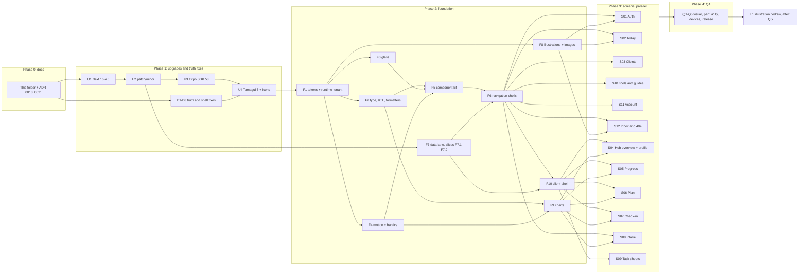
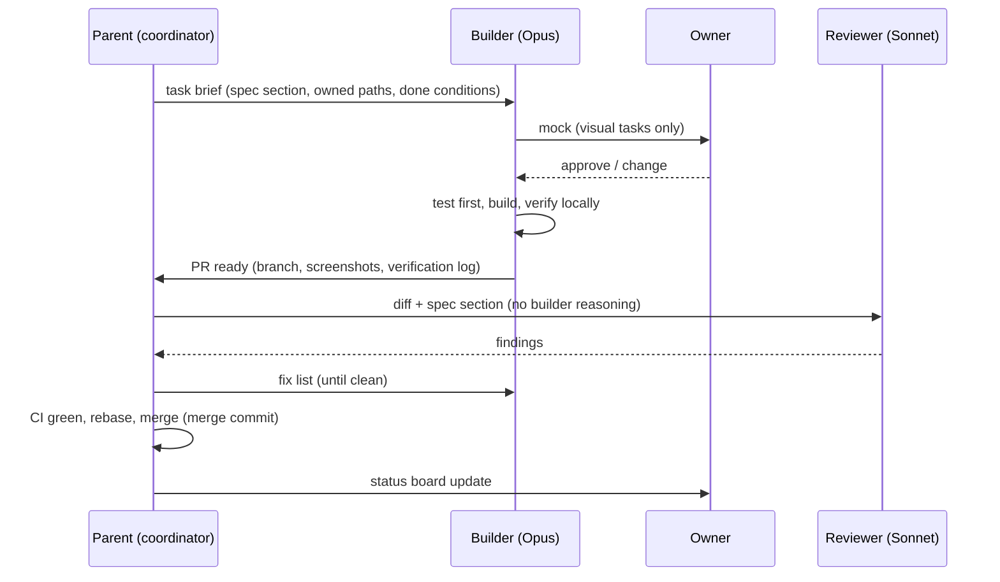

# GymOS UI/UX revamp: program spec

Status: **proposed** until the owner merges this folder with ADR-0018 to ADR-0021. The owner's rulings are recorded in [`rulings.md`](rulings.md).

This folder is the single source of truth for the revamp track. Every revamp PR names the task id it delivers (for example `F3` or `S06`) and links the task's section here.

## 1. Goal

Make the coach app truthful, fast and distinctive on web, iOS and Android:

- **Truthful:** status, dates, units and adherence agree everywhere; no dead ends.
- **Fast:** phone LCP of 2.5 s or less on a cold load; no long task over 200 ms on the roster at 500 clients.
- **Distinctive:** the Floodlight look, glass chrome, the "Pressed, not bounced" motion, native navigation on mobile.

Nutrition safety rules do not change: numbers come only from Layers 1–2, publish is always a human, and allergens are hard-filtered and post-checked.

## 2. Non-goals

- No client or member app. No new product features beyond what the task specs list. Extras go to the README's future work.
- No Urdu translation in this track. The layout is made RTL-ready (logical properties, Urdu font stack, per-locale line height), but translated strings are future work.
- No change to Layer 1–3 behaviour or to the publish rules.

## 3. Evidence and references

| What                                                       | Where                                                                                                                                                                                            |
| ---------------------------------------------------------- | ------------------------------------------------------------------------------------------------------------------------------------------------------------------------------------------------ |
| Audit report (screens, verdict, IA, directions, decisions) | [artifact](https://claude.ai/artifact/6kqJfdnEayt5dLkbgyKwUn) (owner-only), full notes in [`reference/critique.md`](reference/critique.md)                                                       |
| Design research (patterns, libraries, transitions)         | [`reference/research.md`](reference/research.md)                                                                                                                                                 |
| Tokens, colour theory, glass, type                         | [`reference/tokens.md`](reference/tokens.md), [`reference/tokens.floodlight.json`](reference/tokens.floodlight.json), [explorer](https://claude.ai/artifact/5CtV8ocVdgxBLyjXdsrL7a) (owner-only) |
| Motion system and per-widget catalogue                     | [`reference/motion.md`](reference/motion.md), [gallery](https://claude.ai/artifact/LXhg7Dni3NLU8X5HgzqgvS) (owner-only)                                                                          |
| Performance baseline and ranked fixes                      | [`reference/perf-baseline.md`](reference/perf-baseline.md), [report](https://claude.ai/artifact/XdpFBdPKfKyxdZjQMQchkR) (owner-only)                                                             |
| Upgrade spikes                                             | [`reference/upgrades.md`](reference/upgrades.md)                                                                                                                                                 |
| Android measurement kit                                    | [`reference/android-kit/`](reference/android-kit/)                                                                                                                                               |

`reference/` files are snapshots from 2026-11-23. The artifact links are private to the owner; everything a builder needs is in `reference/`. Where they recommend Gym Floor Print, the rulings override them with Floodlight.

## 4. Phases and dependency graph

- **Phase 1 has two lanes.** The upgrades are serial (each rebases on the last). The six truth and shell fixes ([`15-fixes.md`](15-fixes.md)) run in parallel with U1–U3 because they touch different files; all of them merge before U4 starts, because U4's codemod rewrites style props across the tree.
- **Phase 2 runs F1 first.** F2, F3, F4 and F8 then run in parallel, because they own different folders (§6). F5 starts when F2–F4 have merged, F9 when F2 and F4 have. F6 follows F5 and the F7.1 and F7.2 slices, and F10 follows F6 and F7.3. F7 (API and contracts) runs from U2 onwards in parallel with everything, one slice per PR.
- **Phase 3 runs all screens in parallel.** S01–S03, S08 and S10–S12 start once F6 has merged; S04–S07 and S09 once F10 has. A screen also waits for its F7 slice (listed in its spec) and its approved mock.
- **After the track:** L1 redraws the illustrations (rulings O6). It is low priority and swaps art behind F8's exports, so no screen changes.
- **Mocks start early.** A screen's mock can start once the F5 kit sheet is approved, so mock review overlaps the F6–F10 builds. Only screen code waits for the gates.

## 5. Roles and loop

The parent agent:

- keeps [`status.md`](status.md) current;
- assigns tasks;
- owns the two change lanes (§6);
- serialises merges in dependency order;
- rebases waiting branches after each merge;
- stops a builder that edits paths it does not own.

Builder and reviewer briefs follow [`agents.md`](agents.md).

## 6. File ownership and change lanes (conflict prevention)

| Owner                 | Paths                                                                                                                                                                                                                                                                                                                                                                                                                                                                                                                                                                                                                                                                                         |
| --------------------- | --------------------------------------------------------------------------------------------------------------------------------------------------------------------------------------------------------------------------------------------------------------------------------------------------------------------------------------------------------------------------------------------------------------------------------------------------------------------------------------------------------------------------------------------------------------------------------------------------------------------------------------------------------------------------------------------- |
| U1–U4 (one at a time) | `package.json` files, `pnpm-lock.yaml`, `pnpm-workspace.yaml`, `apps/mobile/app.json`, config files the upgrade guides name, plus the code fixes each U section lists                                                                                                                                                                                                                                                                                                                                                                                                                                                                                                                         |
| B1–B6                 | The files each fix names in [`15-fixes.md`](15-fixes.md); no two B tasks share a file                                                                                                                                                                                                                                                                                                                                                                                                                                                                                                                                                                                                         |
| F1                    | `packages/ui/src/tamagui.config.ts`, `packages/ui/src/breakpoints.ts` (the width ranges, O8), `packages/platform/src/theme-mode*`, `packages/ui/src/tokens/**` (new), `packages/ui/src/theme/**` (new), `infra/tenants/pilot.json` and the tenant manifest loader (CODEOWNERS), `docs/design-system-reference.md`, plus the provider files the runtime theme needs (`packages/app/src/provider/**`, `apps/web/components/next-tamagui-provider*`, the theme part of `apps/mobile/src/mobile-providers.tsx`)                                                                                                                                                                                   |
| F2                    | `packages/ui/src/components/typography.tsx`, `packages/ui/src/fonts/**` (new), font loading in `apps/web/app/layout.tsx` and `apps/mobile/src/mobile-providers.tsx`, `packages/app/src/lib/format/**` (new: dates, units, adherence, phone, status words), `packages/app/src/lib/phone.ts`, `packages/app/src/lib/unit-prefs.ts`, `packages/app/src/lib/goal-pace.ts` and `pace-control.ts` (the pace formatter), plus a one-time exception to change only direction props in the 15 files listed in F2, `eslint.config.mjs` (the direction-prop rule), the `fonts` block of `packages/ui/src/tamagui.config.ts` (after F1 merges) and the web `@font-face` rules in `packages/ui/src/fonts/` |
| F3                    | `packages/ui/src/glass/**` (new), `packages/platform/src/blur*` and `packages/platform/src/reduce-transparency*` (new)                                                                                                                                                                                                                                                                                                                                                                                                                                                                                                                                                                        |
| F4                    | `packages/ui/src/motion/**` (new), `packages/ui/src/components/fade-in.tsx`, `stagger-item.tsx`, `skeleton.tsx`, `gymos-toast.tsx`, `packages/platform/src/haptics*` (new), `apps/web/app/globals.css` (motion variables), `apps/mobile/app.json` (120 Hz key)                                                                                                                                                                                                                                                                                                                                                                                                                                |
| F5                    | `packages/ui/src/components/**` except the files F2, F4 and F9 own; moves `signature-pad*.tsx` and `phone-field.tsx` from `client-onboarding`, and `packages/app/src/features/height-fields.tsx`, into the kit, updating their imports                                                                                                                                                                                                                                                                                                                                                                                                                                                        |
| F6                    | `packages/app/src/features/shell/**`, `apps/mobile/app/_layout.tsx`, `apps/mobile/app/(coach)/**` layouts and the move into `(tabs)` stacks, `apps/mobile/app/(auth)/_layout.tsx`, `apps/web/app/(coach)/layout.tsx`, `apps/web/app/layout.tsx` (after F2), `apps/mobile/app.json` (after F4)                                                                                                                                                                                                                                                                                                                                                                                                 |
| F7                    | `apps/api/src/routes/**`, `apps/api/src/schemas.ts`, `apps/api/tests/**`, `packages/modules/**`, `packages/contracts/**` (including the OpenAPI spec), `packages/app/src/api/**`, `apps/web/lib/prefetch-*`                                                                                                                                                                                                                                                                                                                                                                                                                                                                                   |
| F8                    | `packages/ui/src/illustrations/**` (new), `apps/web/public/**` images, `apps/web/app/icon.png`, `apps/mobile/assets/icon.png`                                                                                                                                                                                                                                                                                                                                                                                                                                                                                                                                                                 |
| F9                    | `packages/ui/src/components/weight-chart*`, `weave-line.tsx`, `gradient-ring.tsx`, `dual-rings.tsx`, `packages/app/src/features/charts/**`, `packages/app/src/features/client-detail/client-weight-journey-chart.tsx`, `packages/ui/src/components/macro-bar.tsx` (new)                                                                                                                                                                                                                                                                                                                                                                                                                       |
| Q0                    | `scripts/perf/**` and `scripts/visual/**` (new), the move of `docs/revamp/reference/android-kit/` into `scripts/perf/android/`, the "Reproduce" section of `reference/perf-baseline.md`                                                                                                                                                                                                                                                                                                                                                                                                                                                                                                       |
| F10                   | `packages/app/src/features/client-shell/**` (new), `packages/app/src/features/client-detail/client-hub-header.tsx`, `client-hub-more-menu.tsx`, `client-hub-menu-row.tsx`, `client-hub-tabs.ts`, `apps/web/app/(coach)/clients/[clientId]/layout.tsx` and its sheet slots (new), the native client stack layout, and the `progress`, `profile`, `journey` and `history` route files on web and native until it merges (then S05 owns Progress and S04 owns Profile); `packages/app/src/features/client-detail/index.tsx` until it merges (then S04)                                                                                                                                           |
| L1 (after Q5)         | The art inside `packages/ui/src/illustrations/**` and `apps/web/public/auth/**`; F8's exports stay as they are                                                                                                                                                                                                                                                                                                                                                                                                                                                                                                                                                                                |
| S-tasks               | Their own `packages/app/src/features/<feature>/**` plus their thin route files in `apps/web/app/**` and `apps/mobile/app/**`, listed per screen                                                                                                                                                                                                                                                                                                                                                                                                                                                                                                                                               |

**Kit lane:** after F5 merges, a screen that needs a new or changed shared component files a kit request with the parent. The parent either builds it in a short `feature/kit-<name>` PR that merges before the screen, or approves the screen keeping a local component inside its feature folder until a later kit PR promotes it. Screens never edit `packages/ui` directly.

**Contracts lane:** API, module or contract changes go through F7, or a follow-up `feature/data-<name>` PR, owned by the parent. Screens consume the merged contract and never edit it.

**CODEOWNERS:** any PR touching `packages/core`, `packages/ai` or `infra/` needs the owner's review before the parent merges it.

**Shared config files:** `package.json` files, `pnpm-lock.yaml`, `apps/mobile/app.json`, and the barrels `packages/ui/src/index.ts` and `packages/platform/src/index.ts`. Any task may add its own entries there, and only its own: a dependency it installs or removes, one `app.json` key, its exports. The parent merges such PRs one at a time, and the next one rebases (lockfiles are regenerated, not hand-merged). This is the one exception to "no two parallel tasks share a file".

**Dependencies:** each task's "Install" line lists the only packages it may add. For this run the owner allows them through the guard exception in rulings O5: each install asks for confirmation. Any other dependency stops the builder.

## 7. Gates

1. **Spec gate.** The task has a section here with owned paths and done conditions.
2. **Mock gate** (visual tasks). The builder delivers a mock before screen code:
   - Light and dark.
   - 1440 and 390 px on web, plus iOS native chrome.
   - Tablet in portrait and landscape (rulings O8).
   - Real states: populated with overdue-heavy data, empty, loading, error.

   The owner approves.

3. **Review gate.** A fresh reviewer reports clean against the spec, `AGENTS.md`, the global done conditions (§8) and the task's own. Findings are fixed, not argued, unless the reviewer is wrong with evidence.
4. **CI gate.** All required checks green. Lighthouse and device runs are recorded in the PR but are not CI gates.
5. **Merge.** The parent merges with a merge commit in dependency order. CODEOWNERS paths wait for the owner.

## 8. Global definition of done (every task)

- Meets every done condition in its own section.
- A test that fails before the change; `pnpm lint`, `pnpm typecheck`, `pnpm test` (scoped; full workspace when contracts or shared types change), `pnpm format:check`, `pnpm --filter @gymos/web build`, and `npx expo export --platform ios` when mobile or shared UI changes. Until U1 merges, `next build` refuses to run under an agent (`SecurityFatalError` on 16.4.3), so Phase 1 tasks take the web build result from CI.
- Screenshots in the PR body for every changed state (web 1440 and 390, iOS, iPad in portrait and landscape; light and dark), linked by `raw.githubusercontent.com` URLs from the `screenshots` branch.
- Accessibility:
  - WCAG 2.2 AA contrast from tokens.
  - 44 pt targets.
  - Labelled controls; web accessibility labels reach the DOM as `aria-*`.
  - Visible focus.
  - Colour is never the only signal.
  - Reduced motion and Reduce Transparency honoured.
- RTL-ready: logical properties only (`marginStart`, `paddingEnd`); directional icons mirror.
- Loading, empty and error states, with no infinite spinner.
- Performance budget for the touched screen held (§9).
- `docs/specs/` updated when behaviour changes; README checked and updated when setup, scripts or scope change.
- PR body names the task id, the spec section, the ADR and the evidence.

## 9. Performance budgets (from the baseline)

| Metric                                 | Baseline (2026-11-23)                       | Budget                                 |
| -------------------------------------- | ------------------------------------------- | -------------------------------------- |
| Phone LCP, cold (Lighthouse mobile)    | 3.5–7.1 s                                   | ≤ 2.5 s                                |
| Phone TBT, cold                        | 110–590 ms                                  | ≤ 200 ms                               |
| Roster DOM at 170 clients              | 5,795                                       | ≤ 1,200 at any roster size             |
| Roster longest task (4× CPU)           | 534 ms cold (Lighthouse); 972 ms signed-in  | ≤ 200 ms at 500 clients, signed-in     |
| Web JS (uncompressed, shared)          | about 1.5 MB                                | ≤ 1.0 MB                               |
| iOS JS bundle                          | 6.5 MB (7.0 MB Hermes; 9.3 MB after SDK 58) | ≤ 5.0 MB                               |
| Android cold start (TotalTime, median) | not measured                                | ≤ 1.5 s on the low-end phone (O2, O11) |
| Android janky frames scrolling roster  | not measured                                | ≤ 5%                                   |

## 10. Task index

| Id      | Task                            | Spec                                                                                      | Depends on                                  | Mock                             |
| ------- | ------------------------------- | ----------------------------------------------------------------------------------------- | ------------------------------------------- | -------------------------------- |
| U1      | Next.js 16.4.6                  | [10-upgrades.md#u1](10-upgrades.md#u1-nextjs-1646)                                        | docs                                        | no                               |
| U2      | Patch and minor bumps           | [10-upgrades.md#u2](10-upgrades.md#u2-patch-and-minor-bumps)                              | U1                                          | no                               |
| U3      | Expo SDK 58                     | [10-upgrades.md#u3](10-upgrades.md#u3-expo-sdk-58)                                        | U2                                          | no                               |
| U4      | Tamagui 3.3 and icons           | [10-upgrades.md#u4](10-upgrades.md#u4-tamagui-33-and-a-project-icon-set)                  | U3, B1–B6                                   | no                               |
| B1–B6   | Truth and shell fixes           | [15-fixes.md](15-fixes.md)                                                                | docs                                        | no (bug fixes keep today's look) |
| F1      | Tokens, themes, runtime tenant  | [20-foundation.md#f1](20-foundation.md#f1-tokens-themes-and-runtime-tenant-theming)       | U4                                          | token sheet                      |
| F2      | Type, RTL, formatters           | [20-foundation.md#f2](20-foundation.md#f2-typography-rtl-readiness-and-formatters)        | F1                                          | type sheet                       |
| F3      | Glass                           | [20-foundation.md#f3](20-foundation.md#f3-glass-chrome)                                   | F1                                          | yes                              |
| F4      | Motion, haptics, feedback       | [20-foundation.md#f4](20-foundation.md#f4-motion-package-haptics-and-feedback-primitives) | F1                                          | motion demo                      |
| F5      | Component kit                   | [20-foundation.md#f5](20-foundation.md#f5-component-kit)                                  | F2, F3, F4                                  | kit sheet                        |
| F6      | Navigation shells               | [20-foundation.md#f6](20-foundation.md#f6-navigation-shells)                              | F5, F7.1, F7.2                              | yes                              |
| F7      | Data lane (F7.1–F7.9)           | [20-foundation.md#f7](20-foundation.md#f7-data-lane)                                      | U2                                          | no                               |
| F8      | Illustrations and images        | [20-foundation.md#f8](20-foundation.md#f8-illustrations-and-images)                       | F1                                          | yes                              |
| F9      | Charts                          | [20-foundation.md#f9](20-foundation.md#f9-charts)                                         | F2, F4                                      | yes                              |
| F10     | Client shell                    | [20-foundation.md#f10](20-foundation.md#f10-client-shell)                                 | F6, F7.3                                    | yes                              |
| S01–S12 | Screens                         | [`screens/`](screens/README.md)                                                           | F6 or F10, plus listed F7, F8 and F9 slices | yes                              |
| Q0      | Measurement harness in the repo | [40-qa.md#q0](40-qa.md#q0-measurement-harness-in-the-repo)                                | docs (runs in Phase 1)                      | no                               |
| Q1–Q5   | QA and release                  | [40-qa.md](40-qa.md)                                                                      | all screens                                 | no                               |
| L1      | Illustration redraw             | [40-qa.md#l1](40-qa.md#l1-illustration-redraw-after-q5)                                   | Q5                                          | yes (the owner approves the set) |

Every audit bug and native problem has exactly one owning task in [`30-bug-map.md`](30-bug-map.md).
